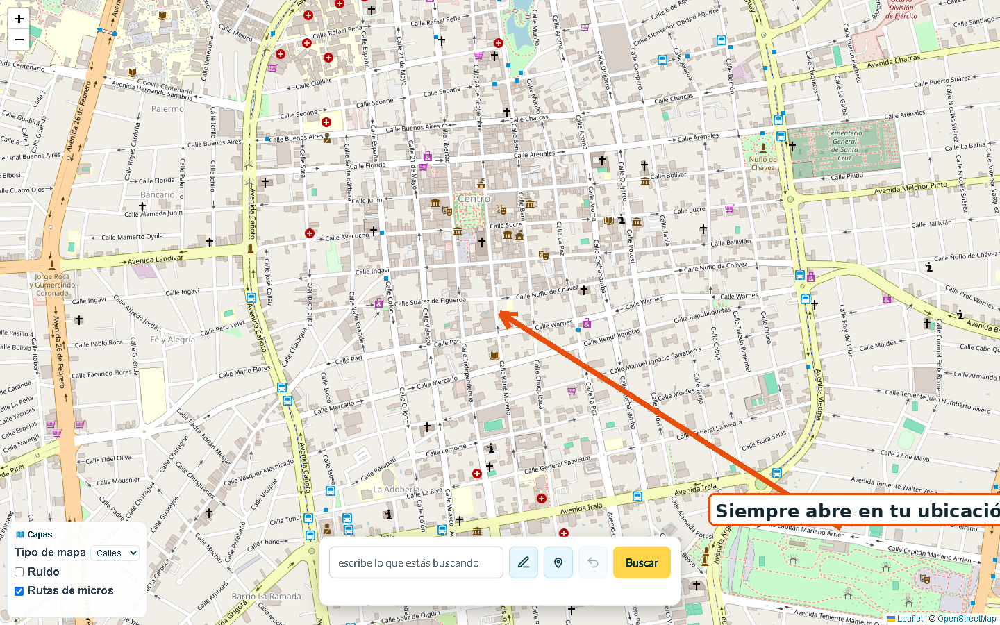

Hasta ahora el mapa recordaba dónde lo habías dejado y volvía a abrir ahí. Cómodo si trabajas siempre la misma zona; raro cuando te cambiaste de ciudad o lo dejaste en un barrio que ya no te interesa.

Queda más simple: al entrar, el mapa se centra donde estás tú, con la misma detección por conexión que ya usábamos.

## Si tu equipo tiene GPS

Tu navegador puede preguntarte si quieres compartir tu ubicación. Si aceptas, el mapa te centra con la precisión del GPS del celular o la computadora, mejor que la aproximación por conexión. Si no aceptas, no pasa nada: te quedas con la detección de siempre.

## Si tienes cuenta

Con sesión iniciada el mapa no va a tu ubicación sino al punto de tu última búsqueda, que es donde estabas trabajando. Eso sigue igual.

## Los enlaces con zona mandan

Si alguien te pasa `statetty.com/?ciudad=cochabamba`, el mapa abre ahí y listo. Los enlaces siempre ganan.

Cuando la detección se equivoca — pasa a veces con datos móviles — arrastra el mapa a tu zona. Sigue sin guardarse nada tuyo: ni la posición del GPS ni la de tu conexión salen de tu navegador; solo sirven para elegir el punto de partida.
