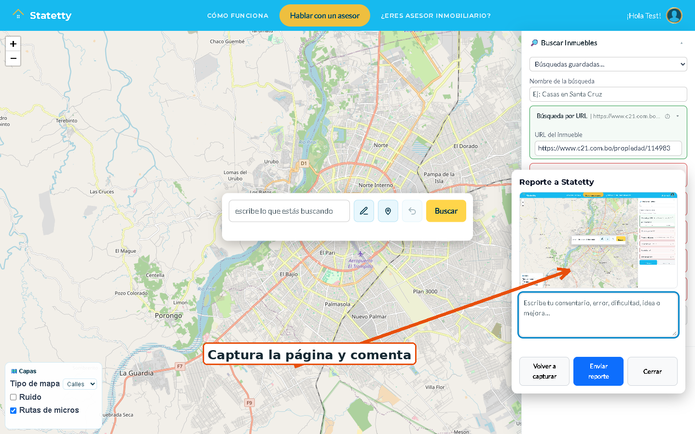

Encontraste un error, una pantalla rara o una idea para mejorar Statetty y no sabías cómo contárnoslo. Ahora hay un botón 📸 fijo en la esquina inferior derecha, disponible en todas las páginas mientras tengas sesión iniciada.

Al tocarlo se hace una captura de la pantalla donde estás, se abre un cuadro para escribir tu comentario y un botón de envío. La captura y el texto llegan directo al equipo de Statetty por Telegram, junto con el enlace de la página y tus datos de contacto, para poder responderte.

## Solo para usuarios registrados

El botón no aparece para visitantes anónimos: es una herramienta interna de soporte y está pensada para quienes ya tienen cuenta, estén activos o no.

## Qué puedes reportar

Cualquier cosa: un error, una dificultad para encontrar algo, una idea de mejora o algo que simplemente no te gustó. Si la captura no se genera bien puedes reenviarla o enviar el reporte solo con texto.

No hace falta que sea perfecto. Cuanto más concreto seas — qué buscabas, en qué pantalla pasó — más rápido lo resolvemos.
