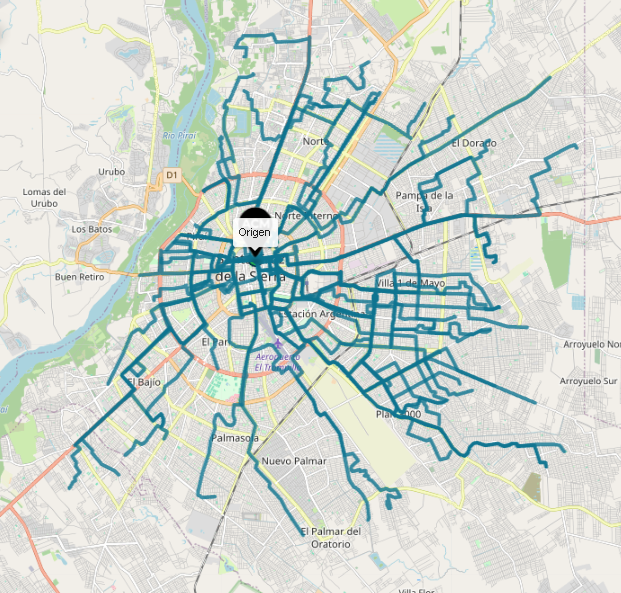

Hay una pregunta que aparece siempre en una visita comercial: *¿por dónde pasa la gente?* Un local en venta, una oficina que se muda, un terreno en una esquina con fachada — el valor de ese inmueble depende, en buena parte, de cuántas personas lo rozan todos los días. Y la respuesta casi nunca está en la ficha: hay que salir a la calle a contar.

En Santa Cruz de la Sierra esa respuesta ya está dibujada. Las rutas de micros son los corredores por donde se mueve la ciudad: cada línea es un flujo constante de pasajeros, clientes y miradas. Un punto por el que pasan cuatro rutas no es lo mismo que uno por el que no pasa ninguna, aunque estén a dos cuadras de distancia.

## Qué tan lejos llega lo que pasa por tu puerta

Pensalo como un análisis de alcance. Si un micro recorre 12 kilómetros, todo lo que está a menos de 50 metros de su recorrido tiene, potencialmente, decenas de miradas diarias. Multiplicá eso por las líneas que tocan el punto y tenés una idea bastante concreta del tráfico peatonal y vehicular que recibe ese local.

Para un agente comercial inmobiliario esto vale oro en dos momentos:

- **Al vender**: cuando alguien evalúa un local o una casa con frente comercial, poder decirle «por acá pasan estas líneas, con estos sentidos y este recorrido» convierte una intuición en un argumento. La fachada deja de ser un detalle y pasa a ser un dato.
- **Al buscar**: si un cliente pide «algo bien conectado», comparás dos zonas en el mapa y ves de inmediato cuál concentra más rutas cerca del punto que le interesa.

## Lo nuevo en Statetty

La herramienta **Rutas de micros** del mapa suma dos formas de leer la ciudad por sus recorridos:

**Rutas que cruzan un punto.** Fijás el origen o el destino en cualquier lugar del mapa —una esquina, la entrada de una tienda, el portón de un terreno— y el botón *«Mostrar rutas que cruzan por Origen/Destino»* lista todas las rutas que pasan a menos de 50 metros de ese punto. Para cada una te muestra el nombre, la dirección, si va de ida o de vuelta y cuántos kilómetros recorre. No hace falta adivinar ni caminar la cuadra: el dato está ahí.

**Comparar rutas por nombre.** En el campo *Ruta:* escribís los nombres que te interesan, separados por coma, y *Mostrar* dibuja todas las que coincidan. Sirve para ver en el mapa cómo se reparten dos líneas parecidas, o para superponer las que pasan por una misma zona y medir cuál cubre más terreno.

Cada sección tiene su propio botón *Limpiar*, así que podés quitar una capa sin borrar las demás y quedarte solo con la comparativa que estás analizando.

## Para qué te sirve en la próxima visita

- Estás por tasar un local en venta: anotá el punto, mirá cuántas líneas lo tocan y sumá ese dato a tu presentación.
- Un cliente duda entre dos zonas: superponé las rutas de cada una y compará cobertura real, no por sensación.
- Querés mostrarle a un propietario lo que tiene: las líneas que pasan por su fachada, en un vistazo.

Leer la ciudad por sus rutas de transporte no reemplaza el trabajo de campo, pero te ahorra el conteo a pie y te da un argumento con números. La próxima vez que alguien te pregunte *«¿y por acá pasa algo?»*, vas a tener el mapa para responder.
