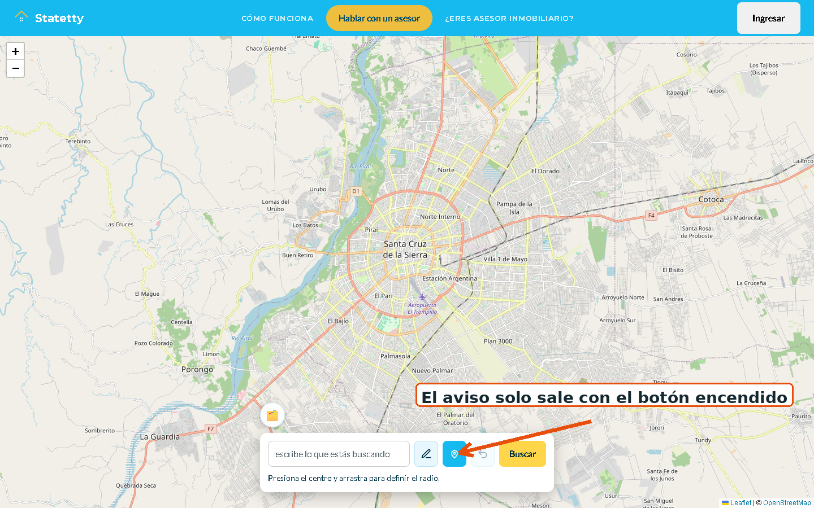



Detalle chico, molestia grande: el lápiz y el pin de la caja de búsqueda se quedaban encendidos después de buscar. Entonces dabas un clic cualquiera en el mapa, para moverte o mirar una zona, y en vez de arrastrar empezabas a dibujar un polígono o una circunferencia sin querer. Tocaba apagar el botón a mano o borrar la figura recién creada.

Ya no pasa. Los dos botones se apagan solos al arrancar una búsqueda y también al concluirla, da igual si la lanzaste desde el Buscar de la caja o desde el formulario «Buscar inmuebles» del menú de usuario. Si tenías el lápiz armado, al terminar la búsqueda el mapa vuelve a lo suyo: clic para moverse, nada más.

También cambió el mensajito de ayuda. Ese «Mantén presionado y arrastra para dibujar el área» ya no se queda colgado en la caja cuando el botón está apagado. Aparece mientras la herramienta está encendida, o si pasas el puntero por encima del botón sin presionarlo, para recordarte qué hace, y se va en cuanto retiras el puntero.

Dibujar sigue igual: aprieta el botón, arrastra sobre el mapa, suelta. Lo que cambia es que la herramienta ya no te persigue después de buscar. Un detalle menos en el que pensar.
