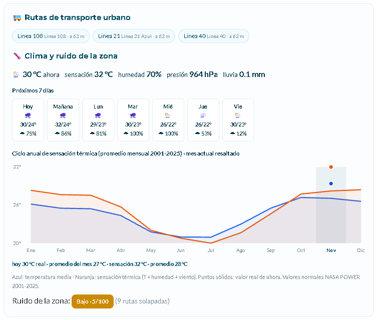



Una ficha de inmueble ya dice bastante: precio, fotos, superficie, ubicación en el mapa. Pero hay preguntas que el comprador hace igual, aunque no aparezcan en ningún campo: *¿pasa el micro por la puerta?*, *¿va a llover cuando vaya a visitar?*, *¿esta zona es un horno todo el año o tiene un invierno decente?*, *¿cuánto ruido hay a la hora de dormir?*.

A partir de hoy la ficha responde esas preguntas sola. Debajo de la galería y antes del mapa aparecen dos cajas nuevas: **«Rutas de transporte urbano»** y **«Clima y ruido de la zona»**.

## Rutas de transporte urbano

La primera caja lista **todas las líneas de micros que pasan a menos de 150 metros** del inmueble, con el nombre de cada ruta, su dirección y la distancia aproximada. Si una propiedad está sobre un corredor con cinco líneas, se ve de una; si está en una calle donde no para nada, también. Es el dato que más cambia la decisión de un comprador y hasta ahora había que averiguarlo caminando la cuadra o preguntándole a alguien que quizás no sabía.

## Clima y ruido de la zona

La segunda caja junta tres cosas que normalmente obligan a abrir tres pestañas distintas:

- **Clima de ahora**: temperatura, sensación térmica (temperatura + humedad + viento), humedad relativa, presión y lluvia del momento.
- **Pronóstico de 7 días**: máxima y mínima por día, probabilidad de lluvia y un ícono del tiempo. Sirve para lo práctico: elegir el día de la visita que no se arruina con un chaparrón.
- **Ciclo anual de sensación térmica**: una gráfica mes a mes con la temperatura media y la sensación térmica promedio del lugar, calculada con 25 años de datos de NASA POWER. El **mes actual va resaltado** y la gráfica marca la temperatura real de hoy contra el promedio de ese mes — así se ve de un vistazo si el clima está más caliente o más frío de lo normal.
- **Ruido**: el índice sonoro de la zona (el mismo mapa de ruido que ya está en el buscador, ahora con detalle a 30 metros del punto exacto) y las rutas que lo componen.

Los datos climáticos vienen de NASA POWER (normales 2001–2025) y Open-Meteo (actual y pronóstico); el ruido, de las 120 rutas de micros mapeadas de Santa Cruz.

## Para quién es

Para el **prospecto**, es la diferencia entre enamorarse de una foto y saber qué compra. Para el **agente**, es material directo para el ACM: conocer la zona antes de la visita evita sorpresas («justo llovió», «no sabía que pasaban tres micros por la vereda») y da argumentos concretos para defender el precio de una propiedad en una zona tranquila o explicar por qué una sobre avenida transitada vale lo que vale.

## Una aclaración

El detalle fino de ruido existe hoy solo para Santa Cruz, que es donde están mapeadas las rutas. El clima (actual, pronóstico y ciclo anual) funciona para cualquier punto donde haya datos de las fuentes. Y hay una vista especial para el agente que comparte la ficha con su cliente: esa versión va limpia, sin estos datos, para no ensuciar la presentación con información que pueda jugar en contra.

Si estás buscando dónde vivir, fijate qué dicen estas cajas antes de agendar la visita. A veces el mejor argumento de venta —o el mejor motivo para descartarla— está en el clima del martes y en la cuadra de atrás.
