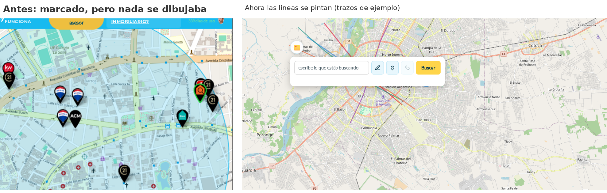

Si estos días abriste el panel Capas del mapa, marcaste «Rutas de micros» o «Ruido» y el mapa siguió igual de limpio, no fue tu conexión ni tu sesión: las capas sí se cargaban. El aviso incluso contaba cuántas líneas encontraba la zona («217 líneas de micros en la zona»), pero sobre el mapa no aparecía ni una.

El motivo fue una regla de estilo que vino de fábrica con la plantilla del sitio y que obliga a todo `canvas` de la página a estirarse al 100% de su contenedor. Justo los canvas que usa el mapa para dibujar esas capas no siguen esa lógica: su tamaño lo calcula el motor del mapa, pixel por pixel. Al forzarlos, quedaban colapsados a cero. Las líneas existían, pero en un lienzo invisible.

Ya está corregido. Al marcar «Rutas de micros» vas a ver las líneas de colores de cada micro que pasa por la zona, recortadas a tu círculo o polígono si dibujaste uno, con el nombre de la línea al pasar el cursor. La capa «Ruido» sufría exactamente el mismo problema y también quedó funcionando: las celdas de colores del índice ahora sí se muestran.

Dos cosas que no cambiaron: las dos capas piden sesión de agente activa, y las líneas de la imagen de arriba son trazos de ejemplo para mostrar el arreglo, no las rutas reales. Si tenías el mapa abierto desde antes, recargá la página una vez para que tome la hoja de estilos nueva.
