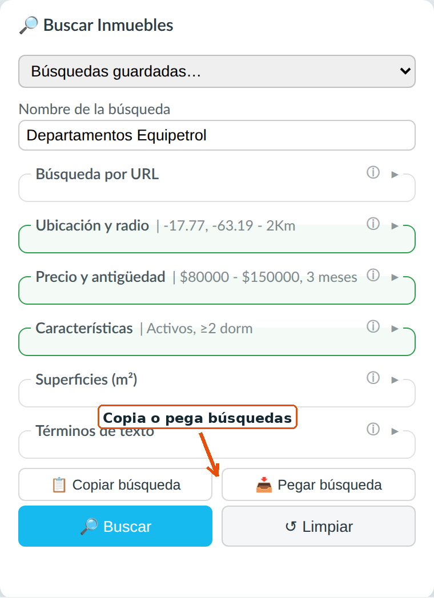

¿Alguna vez quisiste pasarle tu búsqueda a alguien? Tocaba describirla de memoria: «centro en Equipetrol, radio dos kilómetros, hasta 150 mil dólares, dos dormitorios…». Siempre se escapaba algún detalle.

El menú **Buscar inmuebles** tiene ahora dos botones nuevos, justo encima de Buscar y Limpiar:

- **📋 Copiar búsqueda** guarda en el portapapeles el JSON completo de tu búsqueda: todos los filtros que configuraste y, si dibujaste un polígono o una circunferencia en el mapa, también el área. Lo pegas en un WhatsApp y listo.
- **📥 Pegar búsqueda** hace el camino inverso. Copias el mensaje que te llegó, tocas el botón y el formulario se llena solo con esos valores. Si la búsqueda traía figuras, aparecen dibujadas en tu mapa y la vista se encuadra sobre ellas.

El texto no tiene que venir prolijo: si copiaste el mensaje entero («mirá esta búsqueda: {…}, avisame qué te parece»), el botón encuentra el JSON igual. Lo que sí revisa antes de tocar nada: que el texto sea un JSON válido y que traiga al menos un dato que el formulario entienda. Si no, te avisa y deja todo como estaba.

Al pegar, la búsqueda además queda guardada en tu lista: si tenías una elegida en el selector, la reemplaza por completo; si no, ocupa el primer espacio vacío. Y si el JSON trae solo el área dibujada, tus filtros no se tocan; lo único que cambia es el mapa.

Esto abre dos usos que ya nos hacían falta. Uno entre ustedes: pasarle una búsqueda a un colega o a un cliente tal cual la armaste. Otro con soporte: si quieres que te ayudemos a ordenar o mejorar una búsqueda, la copias, nos la mandas y te devolvemos la versión ajustada lista para pegar.

Un detalle por las dudas: el JSON no lleva tu identidad. Los campos de usuario se quitan al copiar, así que compartir la búsqueda no comparte tu cuenta.
