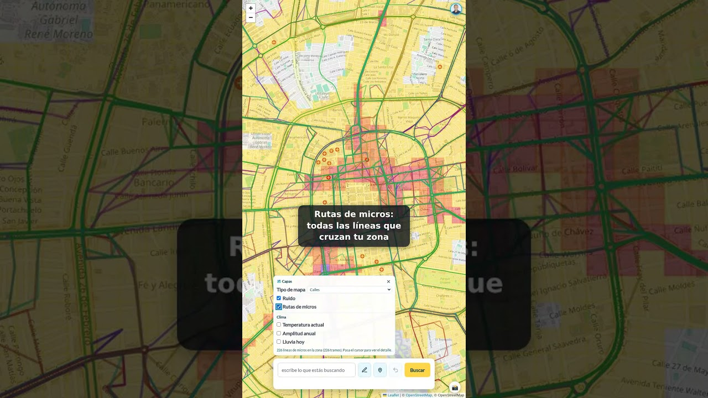

El mapa de Statetty tiene un menú nuevo: el botón 🗂️ **Capas**, junto a la caja de búsqueda. Grabamos un video de un minuto recorriéndolo para que veas exactamente qué hace cada opción antes de tocarla.

  <iframe src="https://www.youtube.com/embed/x75LE0a3xVM" style="position:absolute;top:0;left:0;width:100%;height:100%;" frameborder="0" allow="accelerometer; autoplay; clipboard-write; encrypted-media; gyroscope; picture-in-picture" allowfullscreen title="Video: nuevo menú de capas de Statetty"></iframe>

Lo que vas a encontrar adentro:

- **Tipo de mapa**: calles, satélite o relieve. Cambia la vista completa al instante.
- **Ruido urbano**: pinta cada cuadra según cuánto tráfico de micros recibe, del amarillo tranquilo al violeta intenso. Sirve para descartar zonas ruidosas antes de visitar un inmueble.
- **Rutas de micros**: todas las líneas que cruzan la zona, con el nombre y el sentido de cada una al pasar el dedo. Esta capa pide sesión de agente.
- **Clima**: tres opciones por zona — temperatura actual, amplitud anual y la lluvia de hoy en milímetros y probabilidad.

Todas las capas respetan lo que dibujaste: si marcaste un círculo o un polígono con las herramientas del mapa, ruido, rutas y clima se recortan a esa zona. Sin dibujo, usan lo que se ve en pantalla.

Probalo en [statetty.com](https://statetty.com/) y contanos qué otra capa te gustaría tener ahí.
