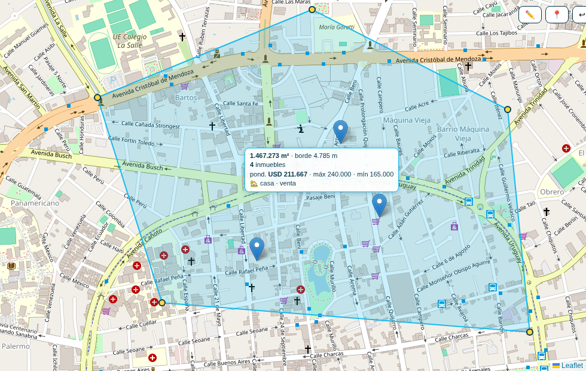

Trazar una zona en el mapa ya no es asunto de pulso. Antes había que apretar el botón del lápiz y arrastrar el puntero de corrido, como firmar con el mouse: salía lo que salía. Ahora cada click deja un punto en su sitio. Con el tercero el área se cierra sola — el último punto se une al anterior y al primero — y a partir de ahí puedes seguir agregando esquinas hasta que la figura te quede como quieres.

Mientras dibujas, el mapa se mueve con normalidad: puedes arrastrarlo o acercar entre punto y punto sin que se te arruine el trazo. Para terminar, apagas el lápiz con el mismo botón. La circunferencia sigue como estaba: aprietas el centro y arrastras el radio.

También cambió el deshacer. Antes borraba la figura entera; ahora quita el último punto colocado, luego el anterior, y así hasta vaciarla. Si un vértice te quedó corrido, lo sacas y marcas otro, sin empezar de cero.

Y hay una novedad que se va a notar enseguida: cada figura lleva pegada una cajita con sus datos. Mientras dibujas muestra los metros cuadrados de superficie y los metros de borde. Cuando haces una búsqueda, la caja se actualiza y te dice cuántos inmuebles cayeron dentro, el precio ponderado (un promedio recortado que no se deja arrastrar por un precio raro), el más caro, el más barato y qué tipo de inmueble y de negocio predominan.

Un uso que se presta solo: compara dos manzanas. Dibujas un polígono sobre cada una y las cajas te dicen al instante cuál tiene más oferta y a qué precios se mueve.
