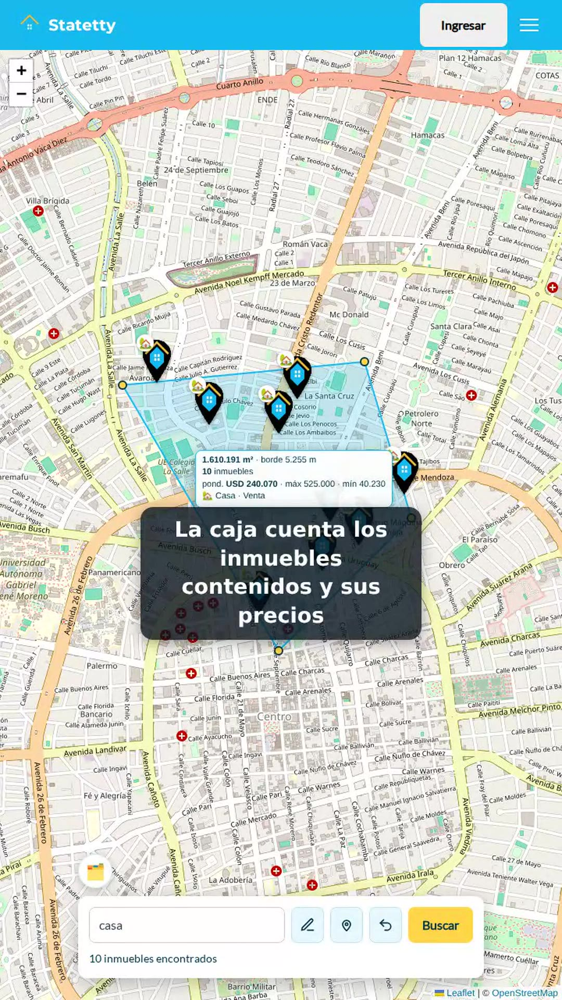

El lápiz del mapa ya dibuja la zona punto a punto: nada de arrastrar de corrido. Grabamos un video de un minuto con el recorrido completo, para que veas cómo queda armada la figura y qué te cuenta la cajita de datos después de buscar.

  <iframe src="https://www.youtube.com/embed/pqKq5BHCIRA" style="position:absolute;top:0;left:0;width:100%;height:100%;" frameborder="0" allow="accelerometer; autoplay; clipboard-write; encrypted-media; gyroscope; picture-in-picture" allowfullscreen title="Video: dibujar polígonos punto a punto en el mapa de Statetty"></iframe>

Lo que vas a ver:

- **Click a click**: cada toque deja un vértice unido al anterior; desde el tercero el área se cierra sola, con una línea que vuelve al primer punto.
- **Deshacer de a uno**: quita el último punto colocado y después el anterior, sin borrarte la figura entera.
- **La caja con los datos**: mientras dibujás muestra superficie y metros de borde; después de buscar suma cuántos inmuebles contiene, el precio ponderado, el más caro, el más barato y qué tipo de inmueble y de negocio predominan.
- **La circunferencia**: sigue como estaba — apretás el centro y arrastrás el radio.

Probalo en [statetty.com](https://statetty.com/) dibujando un polígono sobre tu barrio. Si querés el detalle de cómo funciona por dentro, lo contamos en la [nota del lápiz punto a punto](/poligono-click-a-click/).
