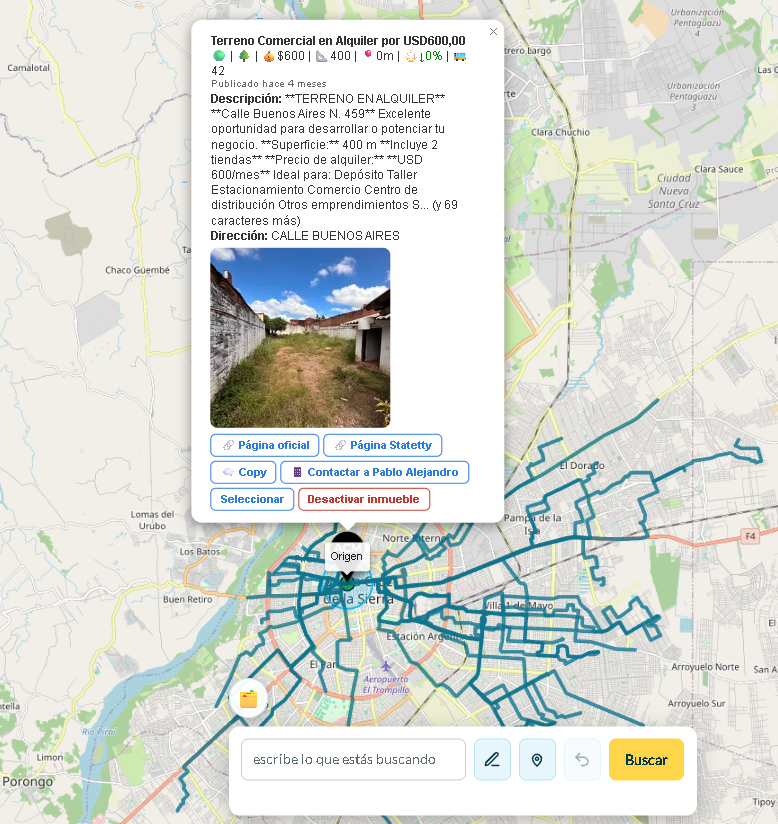



Abre la ficha de cualquier inmueble en el mapa y mira la fila de botones de abajo. Si te aparece uno rojo que dice «Desactivar inmueble», felicidades: tu cuenta tiene confianza máxima y eres de las poquísimas personas que participan en este experimento.

¿Para qué sirve? Para lo que pasa todas las semanas: encuentras un aviso que pinta bien, le escribes al captador y te contesta «lo acabamos de alquilar». El anuncio sigue publicado, pero el inmueble ya no existe como oportunidad. Con ese botón lo marcas como inactivo en el acto, con fecha y hora de la baja. Sale de tu búsqueda y del mapa para todos.

Cada desactivación mantiene los datos al día. Los rastreadores de Statetty detectan solos cuando una publicación desaparece de la página origen, pero a veces tardan días; una persona que acaba de hablar con el corredor sabe la verdad mucho antes que cualquier robot.

Si vas a usarlo, dos reglas:

- Úsalo cuando hayas comprobado que el inmueble ya no está disponible, no porque el aviso no te convenza. Si el captador te dice que sigue vigente, déjalo quieto.
- El botón pide confirmación antes de actuar y queda registrado quién desactivó cada inmueble. No hay vuelta atrás desde la web, así que úsalo con criterio.

¿Y si no ves el botón? Nada cambia para ti: los inmuebles se siguen desactivando solos cuando la página origen deja de existir, como hasta ahora.
