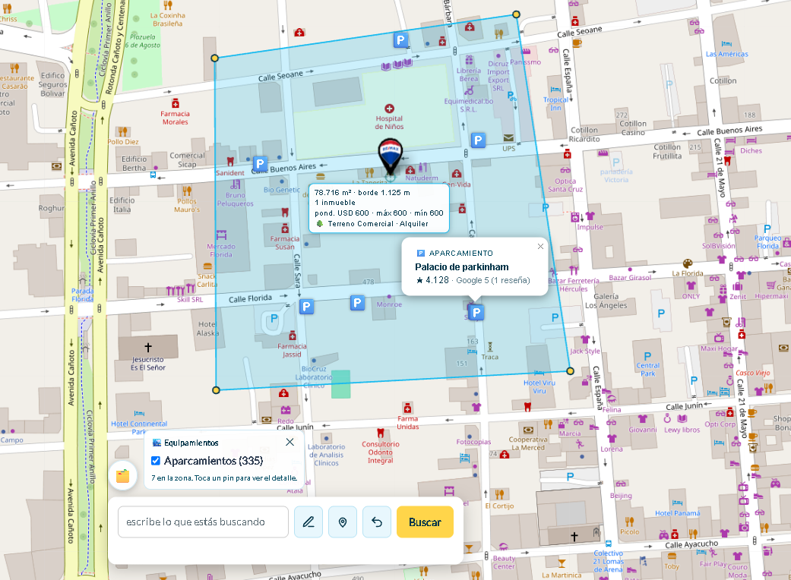



Mira abajo a la izquierda del mapa: junto al icono 🗂️ de Capas hay uno nuevo, 🏙️ **Equipamientos**. Es una herramienta en construcción que va a ir mostrando puntos de servicio de la ciudad — escuelas, farmacias, plazas, hospitales — y ya arrancó con la primera categoría: aparcamientos.

Al marcar «Aparcamientos» aparecen pines 🅿️ sobre el mapa. Si dibujas una zona con el lápiz o el pin, la capa se limita a esa zona; si no, muestra los que caen dentro de lo que estás viendo. Cada pin abre una cajita con el nombre del lugar y su puntaje.

Ojo con el puntaje: no es el promedio crudo de Google. Es una media ponderada: un parqueo con una sola reseña de 5 estrellas no le gana a uno con 4.3 y doscientas. La caja muestra las dos cifras para que compares.

¿De dónde salen los datos? De Google Maps. Estamos peinando Santa Cruz de la Sierra completa con nuestro recolector de negocios; la captura de arriba muestra los primeros 335 encontrados, la mayoría en el centro. El barrido sigue corriendo, así que en los próximos días van a aparecer más.

Por ahora solo hay aparcamientos. Las demás categorías se van a ir sumando en el mismo panel, cada una con su emoji, para distinguirlas de un vistazo.

Si encuentras un parqueo mal ubicado o que ya no existe, avísanos por WhatsApp y lo corregimos.
