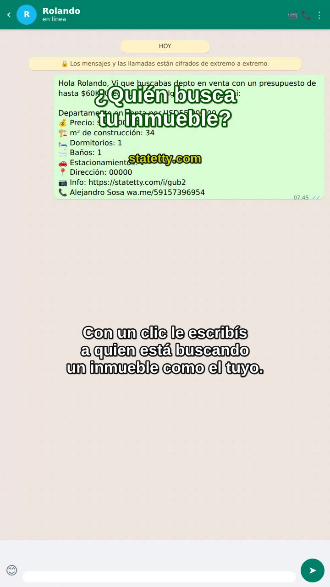

En **Mis captaciones**, junto a cada inmueble hay un botón de binoculares 🔭. Al tocarlo, Statetty revisa los más de 90 mil mensajes que llegan cada día desde más de 100 grupos de WhatsApp y te arma la lista de la gente que buscó un inmueble como el tuyo en los últimos 10 días. Grabamos un video de un minuto con el recorrido completo.

  <iframe src="https://www.youtube.com/embed/0sri1i-BpPw" style="position:absolute;top:0;left:0;width:100%;height:100%;" frameborder="0" allow="accelerometer; autoplay; clipboard-write; encrypted-media; gyroscope; picture-in-picture" allowfullscreen title="Video: los binoculares de Mis captaciones en Statetty"></iframe>

Lo que vas a ver:

- **La lista de quién te busca**: cada requerimiento muestra quién lo pidió, su presupuesto, la zona, el grupo donde lo publicó y a qué hora.
- **Marca y limpia**: podés marcar los ya contactados o quitar los que no te sirven.
- **El mensaje ya escrito**: con un toque más se abre el chat de WhatsApp con el saludo, la referencia a lo que buscaba la persona y la ficha de tu inmueble incluida. Solo queda darle enviar.

Los requerimientos se actualizan solos: hay pedidos de hoy mismo porque la lista se alimenta en tiempo real de los grupos.

Probalo con tus propias captaciones en [statetty.com](https://statetty.com/): entra a **Mis captaciones** y tocá los binoculares de cualquiera de tus inmuebles.
