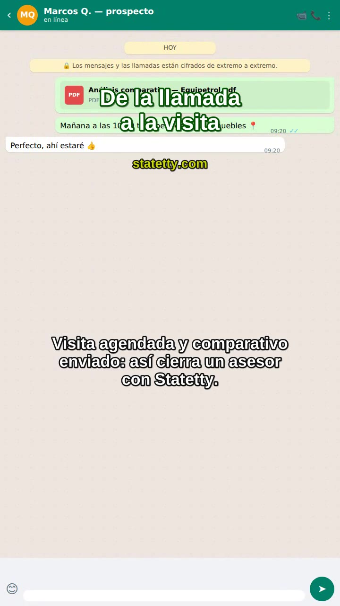
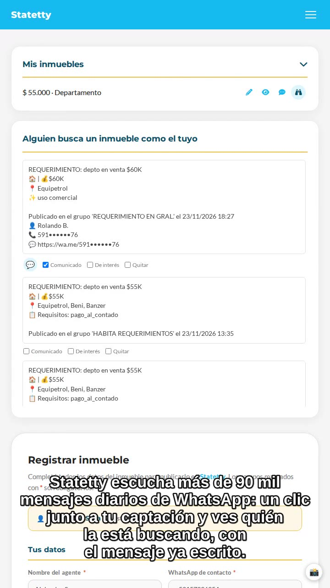
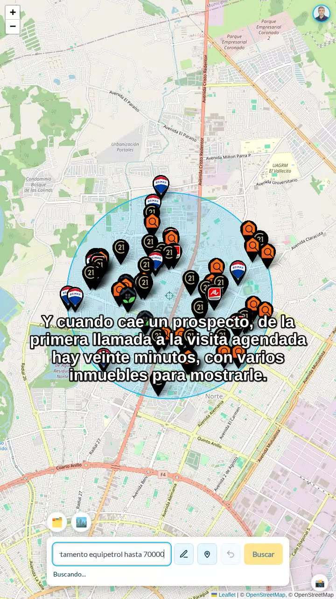
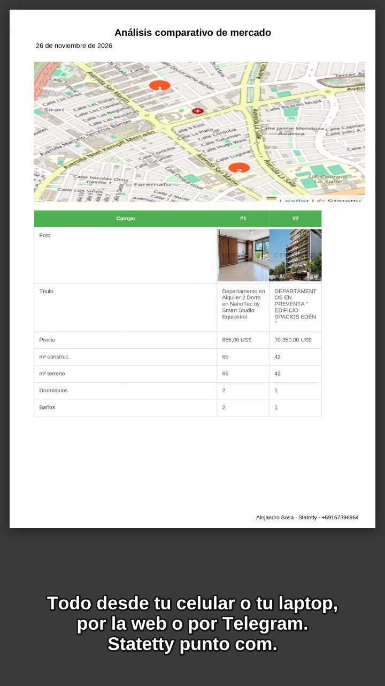
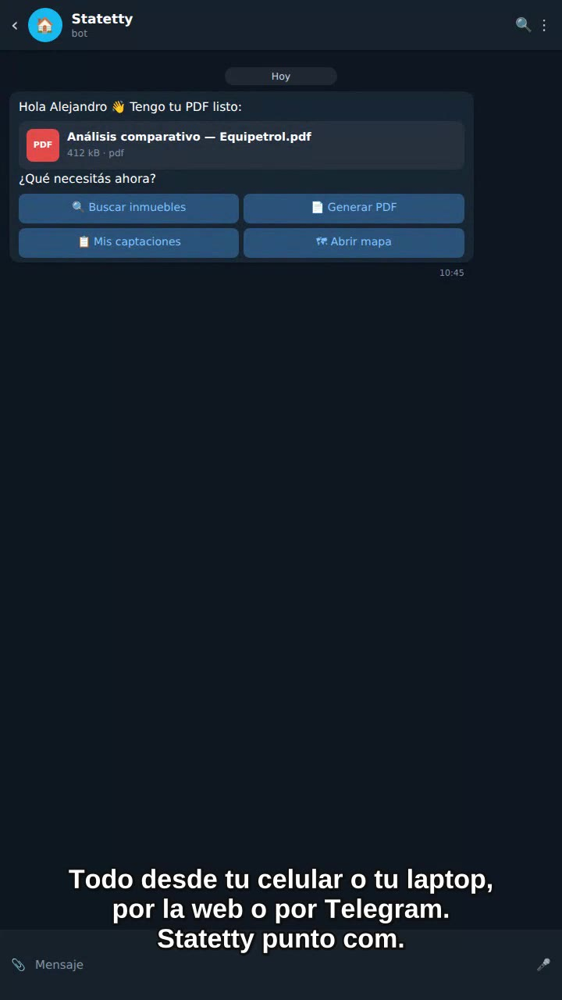

Si sos asesor inmobiliario ya sabés dónde están los clientes: en los grupos de WhatsApp. Ahí tus colegas piden inmuebles a gritos — «busco depto en Equipetrol hasta 60 mil» — pero entre los más de 90 mil mensajes que se mandan al día, encontrar el que te sirve es un trabajo de horas.

**Statetty hace esa escucha por vos.** Es una app para asesores que junta en un solo lugar lo que hoy hacés con diez herramientas sueltas. Este video de un minuto lo resume:

  <iframe src="https://www.youtube.com/embed/aUiSSKlb9yg" style="position:absolute;top:0;left:0;width:100%;height:100%;" frameborder="0" allow="accelerometer; autoplay; clipboard-write; encrypted-media; gyroscope; picture-in-picture" allowfullscreen title="Video: qué es Statetty"></iframe>

## Quién busca lo que vos tenés

En **Mis captaciones**, cada inmueble que registraste tiene un botón de binoculares 🔭. Al tocarlo, Statetty revisa los mensajes de más de 100 grupos de WhatsApp y te devuelve la lista de la gente que buscó un inmueble como el tuyo en los últimos 10 días: quién lo pidió, su presupuesto, la zona, el grupo donde lo publicó y a qué hora.

Un toque más y se abre el chat de WhatsApp con el mensaje ya redactado — saludo, referencia a lo que buscaba y la ficha de tu inmueble incluida. Solo queda darle enviar.

## De la llamada a la visita en minutos

Cuando te cae un prospecto, la búsqueda del mapa te deja filtrar por zona, tipo y precio en segundos: «departamento equipetrol hasta 70000» y tenés los pines sobre la ciudad, cada uno con su ficha, fotos y datos del captador.

## El PDF que defiende tu precio

¿El dueño pide de más? ¿El comprador duda? Seleccionás inmuebles comparables en el mapa y generás un **brochure PDF profesional**: mapa de ubicaciones, fotos, precios, metros cuadrados y el análisis comparativo de mercado. Sirve para ofrecer opciones al cliente o para mostrarle al propietario el valor real de su inmueble.

## En el celular, la laptop o Telegram

No hay nada que instalar: funciona en la web desde cualquier navegador, y el bot de Telegram te da las mismas herramientas en el chat. Lo que empieces en la laptop lo seguís en el celular.

Probalo gratis en [statetty.com](https://statetty.com/): registrate, cargá una captación y tocá los binoculares para ver quién la está buscando.
