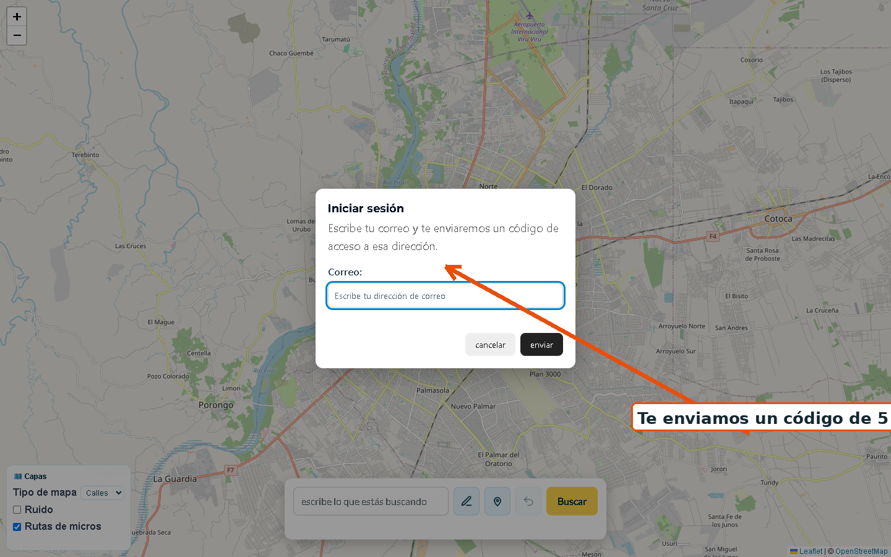



Si te logueabas en el celular y después abrías la laptop, la sesión de una de las dos podía aparecer cerrada sin que tocaras nada. Ya quedó corregido: **cada navegador donde entres con tu correo mantiene su propia sesión**, y ninguna se apaga por usar otra.

¿Qué había detrás? El sistema identificaba cada sesión por el tipo de navegador, y dos equipos con el mismo navegador se veían iguales. Al entrar desde el segundo, el primero quedaba «reemplazado» y en el peor caso se cerraban todas tus sesiones a la vez. Ahora cada navegador lleva una identidad propia, así que laptop, celular y una tercera máquina conviven sin pisarse.

También se endureció el lado del navegador: si la sesión local queda obsoleta, la página la recupera en silencio en vez de mandarte al login, y un corte de internet momentáneo ya no te desconecta.

La sesión sigue cerrándose cuando tiene que cerrarse:

- Tú mismo, con el botón de cerrar sesión.
- Un administrador, si hace falta desloguear tu cuenta en todos lados.

Y hay algo nuevo en el menú de tu cuenta: **«Mis sesiones»** muestra los dispositivos donde tienes la sesión abierta y deja cerrar cualquiera de ellas —o todas menos la actual— si dejaste una abierta donde no querías.

No tienes que hacer nada distinto. La próxima vez que entres con tu código, la sesión se queda.
