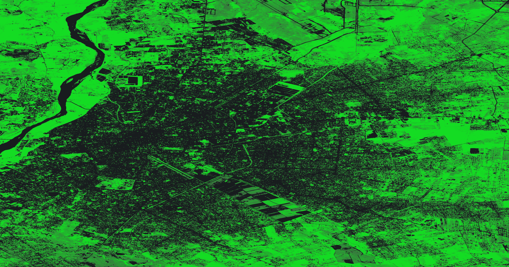



La imagen de arriba es Santa Cruz de la Sierra entera, contada por árboles. La hicimos nosotros, con imágenes de satélite públicas, y ya está convertida en una capa del mapa: en el menú 🗂️ **Capas** (abajo a la izquierda) hay un checkbox nuevo, **«Índice verde»**, debajo del grupo de clima.

Al marcarlo, cada zona del mapa se pinta de rojo a verde según cuánta copa arbórea tiene: verde intenso es barrio bien arbolado, rojo es zona casi desnuda. Pasa el cursor sobre cualquier hexágono y ves el número — un porcentaje de 0 a 100 — y el detalle de dónde sale el dato.

En la ficha de cada inmueble también aparece, debajo del bloque de clima y ruido: «Verde de la zona» con su valor y una comparación frente al resto de la ciudad. Cuando busques casa, vas a poder ver de un vistazo si la cuadra tiene sombra o no.

## Cómo se mide

De momento el índice es una sola fuente: el porcentaje de copa que distingue el satélite Sentinel-2 sobre cada hexágono de ~700 m de ancho. Combinamos seis fotos del último año, casi sin nubes, y nos quedamos con la vegetación que aguanta todo el año — así el pasto de una semana de lluvias no infla el número.

Calibramos el umbral contra un dato medido a pie: un estudio del plan Pdeus contó la copa del distrito central de Santa Cruz (el que va de la plaza hasta el segundo anillo) y obtuvo 13,2 %. Nuestro satélite marca 15,3 % para ese mismo distrito — lo bastante cerca para arrancar, y sabemos exactamente por dónde se desvía.

## Lo que falta

La sombra vista desde arriba no es todo el verde que se siente caminando: una avenida con ceibas se siente más fresca de lo que marca su techo. Por eso el índice va a crecer con dos fuentes más: el verde que se ve a nivel de calle (analizando vistas de 360°) y un censo colaborativo donde ustedes mismos podrán registrar árboles. Cuando entren, el índice pasará a ser un compuesto de las tres señales.

El levantamiento va distrito por distrito, empezando por el centro y avanzando hacia afuera. La cobertura actual del satélite ya es toda la ciudad; las demás fuentes llegarán por etapas.

Si una zona te marca un verde que no calza con la realidad, contanos por WhatsApp — la retroalimentación de la calle es justamente lo que vamos a usar para afinar el índice.
