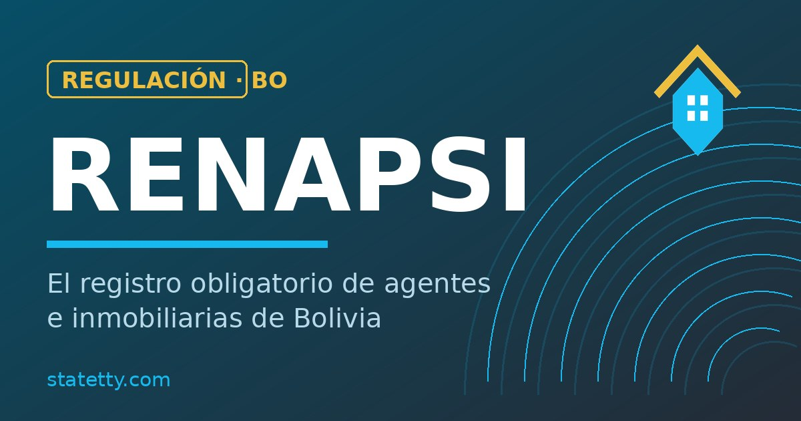

El martes 24 de noviembre, cuando la 5ta Convención de la Cámara Nacional Inmobiliaria de Bolivia ya se moría después de once horas de programa, la maestra de ceremonias anunció «algo que muchos de ustedes habían estado esperando»: la presentación del RENAPSI. La sala del Marriott de Santa Cruz no se había vaciado. Al contrario: cuando el licenciado Walter Quiroz y el doctor Erick Bilbao subieron al escenario, la gente dejó de circular y se sentó a escuchar qué venía el Estado a hacer con su profesión.

Porque eso es lo que es el RENAPSI (Registro Nacional de Proveedores de Servicios Inmobiliarios) para quien vive de esto: la primera vez que el Estado boliviano pone nombre, número y fecha de vencimiento a la actividad del agente. Y llegó con una historia detrás que vale la pena contar completa.

## De dónde salió: la crisis de las cuotas

El 26 de junio de 2026 Bolivia dejó atrás la paridad fija de Bs 6,96 por dólar y estrenó tipo de cambio flexible. En dos meses el dólar pasó a cotizar por encima de Bs 11. Decenas de urbanizaciones de Santa Cruz, muchas de ellas vendiendo lotes en cuotas dolarizadas, re-expresaron los saldos de sus compradores al nuevo tipo de cambio, y las cuotas se les dispararon a familias que habían firmado a 6,96.[^1]

Las protestas arrancaron en julio. En agosto la activista María Galindo ya encabezaba movilizaciones frente a la Catedral cruceña exigiendo que se respeten los contratos pactados.[^2] El Gobierno respondió por partes: el 3 de agosto pactó con la Cámara Inmobiliaria congelar los planes de pago durante ese mes e instaló mesas técnicas;[^3] dos días después, el ministro de Desarrollo Productivo, Óscar Justiniano, hizo una denuncia más grave todavía: que alguien había «entrado al sistema de defensa del consumidor y cambiado información de inmobiliarias», y que las empresas hacían firmar a los compradores contratos distintos de los que habían certificado como libres de cláusulas abusivas.[^4] Para el 17 de agosto, Defensa del Consumidor ya reportaba cláusulas presuntamente abusivas en 14 urbanizaciones y más de mil denuncias procesadas: plazos de mora recortados de 90 a 60 días, prohibición de transferir un lote con deuda, pérdida de todo lo pagado, multas de hasta un dólar por día.[^5]

El 30 de agosto los movilizados se sentaron con las autoridades de Defensa del Consumidor y del Viceministerio de Comercio. Al día siguiente, el 31 de agosto, el presidente Rodrigo Paz firmó en consejo de ministros el Decreto Supremo 5690: el RENAPSI.[^6]

O sea que el registro no nació de un gabinete de planificación: nació de la calle, de miles de familias que descubrieron que quien les vendió el lote podía cambiarles las reglas a mitad de camino y nadie sabía ni quién era ese vendedor formalmente.

## Qué es y quién lo maneja

El decreto tiene cuatro artículos y dice poco: crea el registro, manda a inscribirse a empresas y a personas naturales que trabajan de manera independiente, ordena que la información sea pública y gratuita, y deja los reclamos en los centros de atención de la Ley 453.[^6] Lo administra el Ministerio de Producción Sostenible, Medio Ambiente y Agua, a través del Viceministerio de Comercio y Logística Interna y Derechos del Usuario y Consumidor; o sea, la Dirección General de Defensa de los Derechos del Usuario y del Consumidor, la misma que recibía las denuncias de los loteros.

El reglamento salió el 8 de octubre (Resolución Ministerial 754/2026) y ya lleva dos modificaciones en noviembre: la 853, que postergó la apertura de la plataforma de 20 a 40 días hábiles, y la 877, del 18 de noviembre, cinco días antes del congreso, que amplió las opciones de matrícula en el Registro de Comercio.[^7]

Quienes lo presentaron en la convención:

- **Walter Quiroz Navia**, director general de Defensa de los Derechos del Usuario y Consumidor, presentado como «director nacional del RENAPSI». Empresario cruceño antes que funcionario: fundó Multicompras, cofundó Buhooo y gerencia una distribuidora de Kimberly Clark para tiendas de barrio. Asumió el cargo en enero de 2026.[^8]
- **Erick Ghilmar Bilbao Portanda**, abogado y politólogo paceño, jefe de la Unidad de Proyectos y Difusión de esa dirección. Fue quien explicó el reglamento artículo por artículo.[^9]

## Lo que hay que presentar

El trámite es en línea, sobre una plataforma alojada en el portal del Ministerio y construida por la AGETIC. Para la persona natural los requisitos son: Ciudadanía Digital activa, formulario con valor de declaración jurada, matrícula en el SEPREC, NIT activo, certificado del REJAP (antecedentes penales), fotografía y un pago de Bs 250. Para la empresa, lo mismo del representante legal más logotipo, declaración de sucursales y agentes, y Bs 650.[^7]

Un detalle que los expositores remarcaron y que la prensa confirmó después: la modificación del 18 de noviembre permite que el agente se inscriba en el SEPREC como **auxiliar de comercio o corredor**, sin necesidad de constituirse como empresa unipersonal ni abrir un régimen tributario nuevo: si ya tenía su NIT como profesional independiente, sigue con ese. Eso le bajó el costo de entrada a muchísima gente que hoy vende con nombre propio.

La secuencia: solicitud → revisión (hasta 3 días hábiles, 5 más si el REJAP muestra una sentencia) → se habilita el pago (48 horas, si no se reinicia) → certificado digital con código QR. El certificado dura un año; los emitidos durante 2026, como excepción, valen hasta el 31 de diciembre de 2027.[^7]

Y ojo con lo que sí es un freno de verdad: no accede al registro quien tenga sentencia condenatoria ejecutoriada en los últimos cinco años por delitos contra el patrimonio, la fe pública, delitos financieros y de corrupción, o contra la libertad e integridad sexual. La lista está cerrada a propósito: la difamación, por ejemplo, quedó fuera deliberadamente.

## La pieza clave: la vinculación

Si trabajás en una agencia también necesitás registro propio (con tu matrícula SEPREC y tu NIT) y después te vinculás a esa empresa dentro de la plataforma. Un agente solo puede estar vinculado a una agencia, y la agencia responde ante el cliente por lo que sus agentes hagan en su nombre. Bilbao lo explicó con la lógica del sistema: ante una estafa o un engaño, el registro tiene que poder decir quién generó la actividad, qué agente y qué empresa estaban detrás de esa operación.

Después viene lo visible: registrados tienen que poner su número o el código QR en la publicidad, las redes, los contratos y las oficinas. Y la base pública, gratuita según manda el decreto, mostrará quién está activo, inactivo o sancionado, con foto, nombre comercial, domicilio, contacto y vinculaciones.[^7]

## Lo que cuesta no estar

El régimen sancionador tiene tres pisos: falta leve es amonestación escrita (no exhibir el certificado, publicitar sin el QR, no vincular a tus agentes en diez días hábiles); falta grave son 2.000 UFV, unos Bs 6.721 (reincidir, seguir trabajando con el registro vencido, operar con agentes sin registro); y falta gravísima son 5.000 UFV, unos Bs 16.802, más suspensión de uno a seis meses o cancelación del registro. Esa es la categoría de trabajar sin registro vigente y de dar datos falsos que induzcan a error al cliente.[^7]

«Queremos que nunca se aplique», dijo Bilbao en el escenario, y sonó sincero: el modelo que describieron se apoya más en la verificación pública que en la persecución.

Hay un agujero, eso sí, y la prensa ya lo señaló: los artículos que fijan las multas hablan de proveedores «con registro», y no queda claro cómo se sanciona a quien simplemente nunca se inscribió.[^7] El plan de la Dirección es otro: que el mercado mismo expulse al informal cuando el cliente aprenda a verificar el certificado antes de contratar.

## Lo que preguntó el sector, que es lo que le preocupa a todo el mundo

La ronda de preguntas fue por regional y ahí salieron las dudas reales, que no son las del consumidor sino las del agente:

**La Paz** fue directo al punto débil: el registro protege al consumidor, pero ¿quién protege al agente? El sector está «totalmente vulnerable», dijo el vocero: expuesto a que no le paguen la comisión y a que el cliente lo difame después del negocio. La respuesta de Quiroz fue la noticia de la noche: están cerrando un convenio con el **Sistema del Notariado Plurinacional (SINPLU)** para que, al documentar una operación, el sistema pregunte primero si el agente está registrado y después, esto es lo importante, si ya le pagaron su comisión, antes de emitir los documentos. Además se negocian beneficios con el Banco Unión (líneas de crédito, tasas) y tratamiento tributario con el SIN para quienes se registren.

**Potosí** preguntó cómo se combate la informalidad y cómo se diferencia al profesional capacitado del improvisado. La respuesta: diferenciación pública por la base gratuita, el filtro REJAP como primer elemento de ética («una persona con antecedentes por estafa tiene que salir del mercado») y las 40 horas anuales de capacitación obligatoria para renovar, cuyos temas se fijarán cada año en consenso con el sector, prometieron.

**Beni** trajo dos cosas: la difamación posterior al negocio, y qué pasa con quien ya trabaja formal bajo una franquicia que le pide REJAP, fotos y ciudadanía digital desde antes. Respuesta: mesas de trabajo con el IBNORCA desde enero de 2027 para fijar, junto a franquicias y marcas, los parámetros mínimos para comercializar un inmueble. Y sí, el REJAP ya lo exigen las matrices internacionales, no es una invención boliviana.

La última pregunta fue la más incómoda: ¿qué pasa con el representante legal ante una denuncia, una difamación le puede costar la licencia? ¿Habrá programas de cumplimiento como atenuante? Ahí Bilbao bajó el tono de la sala: la difamación no está entre los delitos que inhabilitan, y antes de actuar hay un plazo de verificación y cruce de información. «Lo que no se quiere es perjudicar a las personas.»

## Quién gana y qué se puede torcer

Mirado con honestidad, el reparto es este:

El **consumidor** gana una verificación gratuita y una vía de reclamo institucional con nombre y domicilio. El **agente formal** gana un acto administrativo que legitima su trabajo («tengo un registro, un certificado otorgado por el Estado», como lo repitieron varias veces) y, si el convenio del SINPLU se concreta, el primer respaldo real para cobrar la comisión, que es el dolor más viejo del oficio. El **Estado** gana algo que necesita por otra razón: sacar a Bolivia de la lista gris del GAFI, donde entró en junio de 2025. Los inmobiliarios ya eran «sujetos obligados» de la UIF desde 2023, y este registro ordena ese padrón.[^10] Y el **mercado** gana transparencia en un sector donde, según la estimación oficial de 2022, solo el 5% de los operadores era formal.[^11]

Lo que se puede torcer también está claro:

- **La informalidad pura** es el agujero del diseño: si la sanción efectiva solo alcanza a los registrados, el que nunca se inscribe apuesta a que la verificación del cliente lo expulse. Es una presunción fuerte del modelo.
- **La barrera de entrada** es real para el agente chico: Ciudadanía Digital + SEPREC + NIT + REJAP + pago anual no es un trámite liviano en provincia.
- **La norma se mueve**: dos modificaciones del reglamento en diez días muestran una regulación que se escribe mientras se aplica. Bienvenida la corrección (abrir el SEPREC a auxiliares y corredores fue un alivio concreto), pero la incertidumbre también cuesta.
- **El REJAP es un filtro ciego**: una sentencia mal asentada puede bloquear a un inocente, y a la inversa, alguien con causas no resueltas pasa limpio.
- **Sin plataforma no hay registro**: la apertura ya se postergó dos veces y, según el cómputo de El Post, la inscripción habilitaría recién el 9 de diciembre o el 15 de enero, dependiendo de desde cuándo se cuenten los 40 días hábiles.[^7]

## El telón de fondo

Vale dejar constancia de algo que en la sala se mencionó de pasada: Quiroz dijo que registros como este bajaron el «riesgo país de nivel 7 a nivel 4». La cifra no se corresponde con ningún índice publicado tal cual, pero el contexto sí es real: el riesgo país EMBI de Bolivia cayó de más de 2.000 puntos en 2025 a menos de 500 en octubre de 2026, el índice Basel AML bajó de 7,38 (2015) a 5,58, y el Gobierno está desplegando un paquete de registros (RENAPSI, sujetos obligados de la UIF) para salir de la lista gris del GAFI.[^10][^12] El agente inmobiliario boliviano, le guste o no, quedó dentro de la arquitectura antilavado del país.

## Lo que queda

Cuando terminó la ronda de preguntas ya era de noche y la convención cerraba ahí mismo. Lo que quedó en el aire es más grande que un trámite: por primera vez el ejercicio del agente inmobiliario en Bolivia tiene forma de profesión regulada, con identidad verificable, antecedentes revisados, capacitación anual obligatoria y un nombre que el cliente puede comprobar.

Eso es lo que el sector venía pidiendo desde hace años sin mecanismo que lo obligara. La Cámara lo pedía ya en 2022, cuando solo el 5% de los operadores era formal y las inmobiliarias piratas «aparecían y desaparecían» después de vender.[^11] Ahora el mecanismo existe: imperfecto, recién nacido, con la plataforma por estrenar y un esquema sancionador que tiene un agujero visible. Pero existe.

Para el agente la cuenta es simple: inscribirse cuesta Bs 250 y un día de trámites; no estar inscrito cuesta que el cliente, el notario y la propia Cámara lo sepan. Y la profesionalización que los congresos llevan años predicando (capacitación, ética verificable, separación del que trabaja bien del que improvisa) ahora tiene una infraestructura detrás y dejó de ser pura intención de discurso.

Nosotros, desde Statetty, ya lo sabemos de otro lado: el agente que se puede verificar vale más que el que no. Cuando la plataforma abra, ahí estará el primer registro público de la profesión.

---

## Referencias

[^1]: [eju.tv — Pagos por terrenos: Gobierno anuncia mesas técnicas tras reclamos por alza de cuotas en Santa Cruz (3-ago-2026)](https://eju.tv/2026/08/pagos-por-terrenos-gobierno-anuncia-mesas-tecnicas-tras-reclamos-por-alza-de-cuotas-en-santa-cruz/)

[^2]: [eju.tv — Galindo lidera una protesta en Santa Cruz que exige mantener el tipo de cambio fijo del dólar en lotes comprados (31-ago-2026)](https://eju.tv/2026/08/galindo-lidera-una-protesta-en-santa-cruz-que-exige-mantener-el-tipo-de-cambio-fijo-del-dolar-en-lotes-comprados/)

[^3]: [Erbol — Contratos inmobiliarios: mantendrán planes de pagos este mes y verificarán «cláusulas abusivas» (ago-2026)](https://erbol.com.bo/econom%C3%ADa/contratos-inmobiliarios-mantendr%C3%A1n-planes-de-pagos-este-mes-y-verificar%C3%A1n-%E2%80%9Ccl%C3%A1usulas)

[^4]: [Video — «Entraron al sistema de defensa del consumidor y cambiaron información de inmobiliarias», ministro Justiniano (5-ago-2026)](https://www.youtube.com/watch?v=2t5lt2SbxhA)

[^5]: [La Razón — Gobierno detecta cláusulas abusivas en 14 urbanizaciones y procesa más de 1.000 denuncias (17-ago-2026)](https://larazon.bo/economia-y-empresa/2026/08/17/gobierno-detecta-clausulas-abusivas-en-14-urbanizaciones-y-procesa-mas-de-1-000-denuncias/)

[^6]: [Decreto Supremo N° 5690 — Gaceta Oficial del Estado Plurinacional de Bolivia (31-ago-2026)](http://www.gacetaoficialdebolivia.gob.bo/normas/verGratis_gob/281328)

[^7]: [El Post — RENAPSI: qué exige a los agentes inmobiliarios y qué gana el cliente (19-oct-2026, actualizado 26-nov-2026)](https://elpost.com.bo/2026/10/19/renapsi-registro-agentes-inmobiliarios-requisitos-costos/) · [Gaceta Ministerial del MPSMAyA — RM 754.2026, 853.2026 y 877.2026](https://dgaj.produccion.gob.bo/)

[^8]: [ANF — Defensor del Consumidor anuncia lista de precios referenciales (29-ene-2026)](https://www.noticiasfides.com/economia/defensor-del-consumidor-anuncia-una-lista-de-precios-referencial-de-productos-de-la-canasta-familiar) · [LinkedIn — Walter Eduardo Quiroz](https://linkedin.com/in/walter-eduardo-q-104887120)

[^9]: [LinkedIn — Erick G. Bilbao Portanda](https://linkedin.com/in/erick-g-bilbao-portanda-43578b23a)

[^10]: [El Post — Qué controles tiene la UIF, que suma a miles de profesionales y denuncia abusos pasados (19-oct-2026)](https://elpost.com.bo/2026/10/19/que-controles-tiene-la-uif-que-suma-a-miles-de-profesionales-y-denuncia-abusos-pasados/) · [GAFI-FATF — ficha de Bolivia](https://www.fatf-gafi.org/en/countries/detail/Bolivia.html)

[^11]: [La Razón — Ley inmobiliaria en ciernes; hay más de 2.000 firmas ilegales (jun-2022)](https://hemeroteca.larazon.bo/economia/2022/06/22/ley-inmobiliaria-en-ciernes-hay-mas-de-2-000-firmas-ilegales/)

[^12]: [La Razón — Gobierno destaca caída del riesgo país de 1.214 a menos de 500 puntos (22-nov-2026)](https://larazon.bo/economia-y-empresa/2026/11/22/gobierno-destaca-caida-del-riesgo-pais-de-1-214-a-menos-de-500-puntos/) · [Basel AML Index — ranking 2025](https://index.baselgovernance.org/ranking)

*La narración de la ponencia proviene de la grabación íntegra del bloque (24-nov-2026, 41:07–1:31 de la grabación R2 de la convención CNIB). Las interpretaciones de siglas deformadas por la transcripción (SEPREC, SINPLU, IBNORCA) fueron verificadas contra las fuentes citadas. Sobre el reglamento citamos al mismo tiempo la ponencia y la cobertura de El Post, que reproduce los artículos de la RM 754/2026 y sus modificaciones.*
