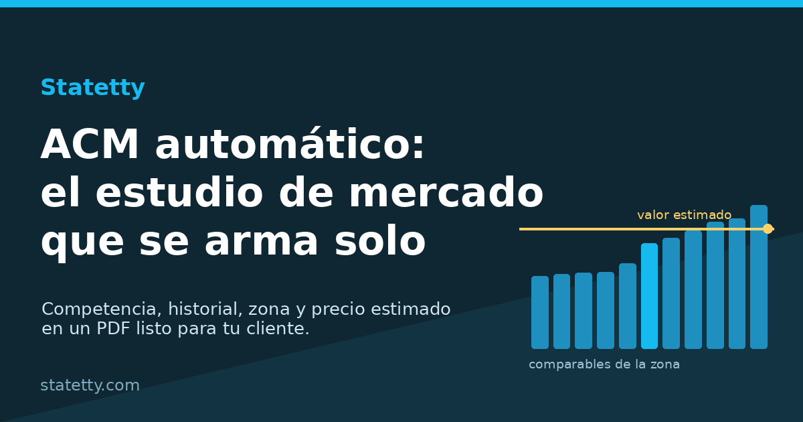



Hasta ahora el ACM de Statetty era una calculadora: vos elegías inmuebles en el mapa, cargabas los USD/m² que creías correctos y la herramienta te daba un valor. Servía, pero el trabajo de armar el estudio quedaba de tu lado.

Ahora el análisis se hace solo. En el formulario de **Buscar Inmuebles** hay un grupo nuevo, «📈 Análisis de mercado (ACM)», con un interruptor. Lo encendés, buscás como siempre, y mientras llegan los resultados el servidor construye el estudio del inmueble que tu búsqueda describe: ese tipo, ese rango de precio, ese tamaño, en esa zona.

## Qué trae el informe

El estudio junta todo lo que la base sabe del lugar. La competencia activa en la zona, con mediana y posición del precio que tenías pensado. Los inmuebles retirados en los últimos 24 meses y cuántos días tardaron en salir del mercado — tiempo que leímos como el plazo realista de una venta o un alquiler. Los datos de la zona que ya conocés de las capas: ruido, verde, líneas de micro y distancia a las puntas de ruta, nivel socioeconómico del manzano y el valor de la tierra estimado desde los lotes en oferta.

Encima de eso, el informe compara la zona con otras de la ciudad que tienen movilidad y precios parecidos, y cierra con un valor estimado en tres escenarios — venta rápida, precio objetivo y posicionamiento alto — más el alquiler ideal si el plan fuera ponerlo a rentar.

## Un PDF distinto, listo para entregar

Cuando el estudio llega, abajo del formulario aparece el botón **🖨️ Imprimir ACM**. Genera un documento vertical de varias páginas, distinto del brochure de inmuebles: ficha del inmueble evaluado, indicadores de la zona, tabla de la competencia, historial de retiros, escenarios de precio y la metodología usada. Tu nombre y tu agencia van al pie de cada página.

Dos cosas que el informe dice con honestidad, porque conviene que tu cliente las sepa: los precios publicados no son precios de cierre, así que el estimado ya descuenta un margen de negociación; y un inmueble retirado no siempre fue una venta — pudo ser un cambio de estrategia o una captación perdida.

## Qué pasó con la calculadora de antes

No se fue. La sección «ACM» del panel de herramientas ahora vive dentro del buscador, abajo de todo, con el nombre **Ajuste manual**: sigue sirviendo para afinar el estimado con los USD/m² de tus propios inmuebles seleccionados en el mapa. La diferencia es que el análisis automático ya le precarga los promedios que encontró en la zona, así que el ajuste arranca desde números reales y no desde cero.

El ACM automático es función de asesor: necesitás sesión iniciada y tiempo activo en tu cuenta. Si tu búsqueda describe poco el inmueble, el estudio lo declara — cada supuesto que hace queda anotado en los avisos del informe, nada se inventa a escondidas.
