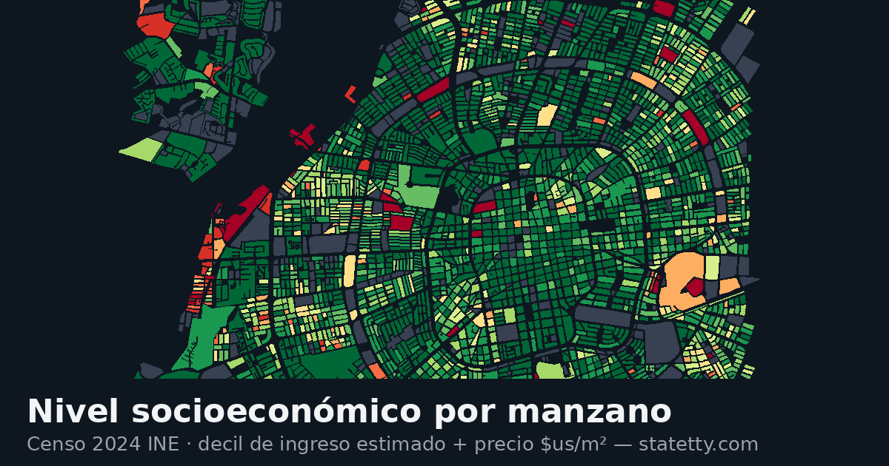



El Censo 2024 del INE publicó las fichas de cada manzano urbano del país: cuántas personas viven ahí, qué nivel de educación alcanzaron, qué tipo de seguro de salud tienen, de qué están hechas sus casas y qué servicios les llegan. Son 247.429 manzanos. La ficha completa está disponible en 131.801 de ellos, que concentran casi el 90 % de la población urbana.

Desde hoy el mapa de Statetty tiene una capa nueva que pone ese dato encima de la ciudad: **Nivel socioeconómico**, en el panel de Capas, junto a ruido y clima. Cada manzano se colorea en una escala de diez pasos, del rojo al verde, según su decil de ingreso estimado dentro del país.

## Cómo se calculó el ingreso

El censo no pregunta cuánto gana la gente. La Encuesta de Hogares 2025 del mismo INE sí, y además registra las mismas características de vivienda, educación, salud y servicios que aparecen en la ficha censal. Con esa encuesta entrenamos un modelo que aprende cuánto ingreso per cápita suele corresponder a cada combinación de rasgos, y luego lo aplicamos a las proporciones de cada manzano. El resultado es un ingreso estimado en bolivianos por mes y un percentil nacional de 0 a 100.

Para revisar que el número tenga pies en la tierra, lo cruzamos con nuestra propia base de anuncios: la correlación entre el índice del manzano y el precio por metro cuadrado de lo que se vende ahí es 0,41. Santa Cruz deja ver la estructura de anillos de la ciudad con una claridad que sorprende.

## Qué muestra al pasar el cursor

Cada manzano responde con su decil, el ingreso estimado, el porcentaje de personas con educación superior, con seguro de salud privado y con internet en casa. Cuando el manzano tiene oferta activa de venta —casas, departamentos, terrenos— aparece también la mediana del precio por metro cuadrado y cuántos inmuebles lo respaldan. Los manzanos grises son los que el INE no liberó por tener pocos hogares.

La capa funciona también dentro de una zona dibujada a mano: con un polígono activo, solo se pintan los manzanos que caen adentro.

## Cómo usarla

Abrí el mapa, acercate a un barrio —la capa pide un zoom mínimo para no cargar miles de polígonos de una vez— y marcá la casilla «Nivel socioeconómico» en el panel de capas. Sirve para responder preguntas que antes costaban un rato de recorrido: ¿este terreno barato está barato porque el entorno es humilde o porque hay una oportunidad en una zona consolidada? ¿El precio que piden está alineado con lo que se vende en la manzana o está por encima?
