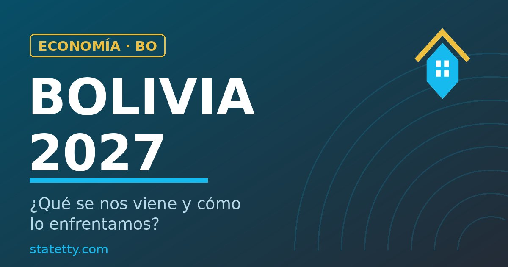



El primer panel del 5to Congreso de Desarrollos e Inversiones Inmobiliarias arrancó a las nueve de la mañana del miércoles 25 de noviembre, en el Hotel Marriott de Santa Cruz, con el salón todavía llenándose de desarrolladores y agentes que venían a escuchar una sola pregunta: ¿qué se nos viene y cómo lo enfrentamos?

El título del bloque era «Bolivia 2027» y la respuesta ocupó cien minutos. Al frente, cinco personas que miden el país desde lugares distintos: **Julio César Valenzuela Roca**, fundador de Citrino Capitales Inmobiliarios, moderando; **Gonzalo Chávez Álvarez**, director de la Escuela de la Producción y la Competitividad de la UCB y el analista económico más citado de la prensa boliviana; **Róger López**, socio fundador de Captura Consulting, la firma que lleva casi tres décadas midiendo al consumidor boliviano; **Orlando Vaca**, presidente de Petrolog S.A., treinta y cinco años en la industria petrolera, ex presidente de Shell para Bolivia y Paraguay; y **Jaime Dunn de Ávila**, financiero, ex presidente del directorio de iBolsa y ex candidato presidencial.

Grabamos la sesión completa. Esto es lo que dijeron, cruzado con los datos que el país fue publicando esos mismos días.

## La macro: cuatro años de contracción y un puente sin playa

Chávez abrió con un tablero que no necesitó adornos. Bolivia cerrará 2026 con una contracción cercana al 3% del PIB, la construcción acumula una caída de 27% y la recuperación, si todo sale bien, llegaría recién en 2028. «Este es el período de recesión más duro desde 1982, 83, 84», dijo, y remató con el dato que ordena todo lo demás: Bolivia es el único país de la región que decrece.[^1]

El origen del shock lo resumió en una frase: «mataron la gallina de los huevos de oro». El gas, que en su mejor momento exportó 6.500 millones de dólares al año y tributaba entre 50% y 60% de la recaudación, hoy exporta menos de mil millones. La minería va a rescatar la balanza comercial (las exportaciones de minerales y oro ya superan los 6.700 millones en lo que va del año y empujan al país hacia un récord exportador[^2]) pero no al Estado: el sector tributa una fracción de lo que aportaban los hidrocarburos.

El resto del tablero: inflación proyectada a 9-9,5% para fin de año (con «cocina estadística para no pasar de 10», ironizó; en el sector construcción el acumulado ya ronda 13%), tipo de cambio paralelo de 11,5 a 12 bolivianos por dólar, déficit fiscal de 9,2%, deuda camino a 100% del PIB y reservas internacionales que el día anterior el Banco Central reportó en 852 millones de dólares, lejos de los 2.500 prometidos, aunque con unos 3.000 millones en oro detrás.[^3]

Sobre el financiamiento internacional fue quirúrgico. El riesgo país cayó de unos 2.000 a cerca de 400 puntos, pero endeudarse en el mercado privado internacional seguiría costando entre 9% y 10% de interés. Y el programa del FMI, que ya desembolsó 211 millones, llega en entregas escalonadas con revisiones: «está bien que venga dinero del FMI, del Banco Mundial, de la CAF, pero si no tienes una idea de qué hay al otro lado del puente, difícilmente la recuperación puede ser sostenida». El Estado, insistió, sigue sin achicarse: «ha pasado más de un año y el gobierno sigue estudiando cómo cerrar una fábrica de papas fritas».

También desmontó la retórica del subsidio. Bolivia ya retiró las subvenciones a los combustibles: lo que hoy encarece el diésel y la gasolina es el precio internacional del petróleo, disparado por la guerra entre Estados Unidos e Irán. «Eso es un impuesto de guerra, una prima de riesgo», dijo, «y el gobierno de manera bastante simplista dice voy a pasar esto a la gente».

Su cierre fue político, no económico: «la salida a la crisis económica está en la política, no está en la economía». Un buen plan de gobierno «no va a salir de Harvard ni de Umamanta», soltó, en alusión al barrio cruceño de Dunn, que agradeció el chiste una hora después. Lo que hace falta, dijo, es capacidad de pactar: pacto nacional, regional y con la gente. Y una nota de optimismo para la sala: si el gobierno decide sostener la demanda agregada, el primer sector en impulsarse será la construcción.

## La micro: el hogar ya hizo su ajuste

López bajó la conversación del PIB a la mesa del comedor. Captura Consulting mantiene un monitor permanente de 850 personas en el eje central, con mediciones bimensuales, y su primera advertencia fue de método: el consumo privado está cayendo más que la economía. Eso es nuevo. Antes el ajuste lo absorbía el gasto público o el comercio exterior; ahora lo paga el hogar. «No va a pasar», advirtió: el escenario duro acompaña dos o tres años más.

Los datos que pesan:

- Ocho de cada diez bolivianos cree que el país va por mal camino. Los dos motivos anclados: crisis económica primero, corrupción segundo. La salida económica está atada, en la percepción de la gente, a la confianza en la dirigencia.
- La pirámide socioeconómica urbana tiene un 63% de hogares pobres, sin ahorro ni cobertura satisfactoria de necesidades, frente a un 37% de clase media para arriba. Y la movilidad entre niveles es baja: «nazco pobre y es poco probable que vaya a la clase media».
- El índice de confianza, construido con el modelo de la Universidad de Michigan, está en el suelo: más de 70% cree que la economía está mal, más de 50% que su propio hogar está mal, y solo un 10% espera que las cosas mejoren en los próximos meses. Por debajo de la línea de 100, el modelo implica contracción del consumo, con más fuerza en desembolsos grandes. Vivienda, por ejemplo.[^4]
- 66% dice que no hará compras importantes en los próximos doce meses (era 62% tres trimestres atrás) y la franja que ya no cubre sus gastos sin tocar ahorros o pedir prestado subió de 17% a 21%.
- El endeudamiento no subió: bajó de 40% a 35%. «No es un tema de demanda de crédito, es un tema de oferta», precisó López. Y del crédito que se toma, el 66% va a gasto corriente (pagar servicios, deudas vencidas, el colegio) y solo un tercio a activos.

El ajuste, además, ya es conducta. La compra planificada desplazó al impulso: de dos a tres puntos de venta visitados, de quince a veinticinco minutos de decisión, 40% decidiendo por precio. Se recorta entretenimiento y comida fuera de casa; se protege alimento, limpieza y educación. «Es muy poco probable que digan me enamoré de la casa, la compro», avisó a la sala.

Su contrapunto valía oro para los presentes: los encargos de estudios de mercado del rubro inmobiliario no se han contraído. Captura hace la misma cantidad de estudios para desarrolladores en 2026 que en 2023. «Los planes, los proyectos, las iniciativas siguen moviéndose en el rubro. Lo que va a tardar es la ejecución», y las pruebas de viabilidad son ahora mucho más estrictas. El sector, dicho de otro modo, está preparando el ciclo siguiente aunque el presente sea flaco.

## La energía: el tren que se fue y el que puede volver

Vaca puso la pieza que faltaba en el relato de Chávez: por qué se acabó el gas. Empezó lejos, con una anécdota de Egipto, donde los proyectos se aprueban no por su retorno sino por el agua dulce que consumen. «Nosotros damos el agua por garantizada», dijo, y de ahí saltó a la nueva métrica mundial del poder: China genera 10,5 teravatios y le sobra; Estados Unidos produce 4,5 y consume 4,5. «Ya no es show me the money. Es muéstrame la energía que tienes y te diré el futuro que veo». Los inversionistas, contó, llegan preguntando cuánta energía disponible queda en el país antes de hablar de montos; la inteligencia artificial y los centros de datos están reordenando el mapa de la inversión global, y la propia Agencia Internacional de Energía proyecta que el consumo eléctrico de los data centers se duplique hacia 2030.[^5]

La historia boliviana la contó por ciclos. Standard Oil encontró petróleo en los años veinte y fue nacionalizada diecisiete años después; Gulf abrió el gas en los cincuenta y fue nacionalizada quince años después; en 1995 se abrieron las puertas otra vez, vinieron las operadoras y se encontraron los megacampos (San Alberto, Sábalo, Margarita, Incahuasi) con veintitrés taladros perforando al mismo tiempo. En 2006 se cambiaron las reglas fiscales a mitad del partido y la exploración se paró por completo. Desde entonces el país vive de lo descubierto antes del 2000.

El detalle contable es brutal: al fijar el precio del condensado y del crudo en 27,11 dólares por barril (con un costo medio de extracción de 25), los campos de petróleo volvieron todos a YPFB. Bolivia producía 25.000 barriles diarios de crudo en 2006; hoy produce 3.000 e importa cerca del 70% de la gasolina que consume. Y las reservas certificadas de gas, publicadas por YPFB el 13 de noviembre —doce días antes del panel—, quedaron en 2,30 TCF, el nivel más bajo en veinte años: al ritmo de consumo actual, el país debería empezar a importar gas hacia 2029-2030.[^6]

La salida, propuso, está en los campos maduros: los yacimientos viejos que las grandes operadoras ya no explotan pero que nichos especializados reactivan en Brasil, Argentina, Ecuador y Colombia. «Si yo ya estoy pagando el precio internacional cuando importo gasolina, ¿por qué no le pago el precio internacional al que viene a producir acá?». Brasil lo hizo con la Resolución 749 de su Agencia Nacional de Petróleo, que reduce regalías sobre la producción incremental de campos de más de 25 años: cinco años después, la producción en tierra volvió a superar a la de mar y 61 campos inactivos retomaron producción.[^7] «Hemos perdido la soberanía energética, pero podemos darle la vuelta», cerró Vaca, y enumeró el respaldo: primeras reservas mundiales de hierro y de litio, top cinco en estaño, plomo, zinc y plata, hidroeléctrica por desarrollar como Rosita, tierras productivas para biocombustibles. Falta una sola cosa: «seguridad jurídica. Nuestro karma de internacionalizar y cambiar las reglas a mitad del juego».

## La crisis debajo de la crisis

Dunn cerró el panel y se llevó la sala. Su diagnóstico: lo grave no es la falta de dólares ni de combustible. «Son las consecuencias de un problema más profundo: un país inmoral, sin ética, sin principios. La economía no es más que la contabilidad del comportamiento humano, y una economía falla primero en sus valores y después en sus números».

Reconoció lo hecho: estabilización en marcha, inflación bajando, riesgo país de 1.200 a cerca de 500, tipo de cambio unificado, 1.900 millones del FMI, 500 del BID, bonos por mil millones y más financiamiento en camino —todo eso la prensa lo confirma: la primera revisión del programa se aprobó esta misma semana y habilita un segundo desembolso de 212 millones.[^8] Pero marcó tres trampas. Primera: las reservas recuperadas son prestadas, no producidas. Segunda: el gradualismo castiga, porque «el que tiene que financiar la espera es la deuda, la idea que tenías el día uno capaz ya no te funciona, y no controlas los eventos del mundo». Tercera, la que dolió más en la sala: el Estado no se está ajustando. Presupuesto 2027 de 250.000 millones de bolivianos, 10% más nominal; masa salarial que sube de 55.000 a 66.000 millones; empresas estatales financiadas con más de mil millones de dólares al año; y una norma presupuestaria que permite a las empresas públicas pagar sus deudas en dólares al tipo de cambio de 6,96 mientras el ciudadano con su préstamo en dólares paga a 12. «Leyes sinvergüenzas, abusivas e inmorales», las llamó.

De ahí su frase del día: «Rodrigo Paz evitó que fuéramos al precipicio, pero nos puso al pie de una montaña que ni siquiera hemos empezado a escalar, con una mochila de 40 kilos cada uno. Y eso empieza en 2027». La primera medida económica que necesita el país, sostuvo, no es monetaria: «Bolivia necesita un shock de justicia. No solo leyes: leyes que se cumplan, porque el primero que las negocia es el Estado. El bloqueador se sienta con el presidente, el avasallador está protegido, se castiga al que trabaja y pagar impuestos se volvió una multa por hacer las cosas bien». Sobre el 50-50 autonómico prometido en campaña fue igual de directo: «en campaña todos son autonomistas, en el gobierno se vuelven centralistas. Y la verdadera descentralización no es cuánta plata te dan, sino cuánto poder te dan».

Cerró con la contracara: «Bolivia no está perdida para nada. La verdadera riqueza del país no está bajo la tierra, no está en el gas ni en los minerales: está sobre la tierra, en la gente dispuesta a trabajar honestamente. Esa gente la veo aquí».

## Lo que el mundo dice sobre estos mismos temas

Nada de lo que se escuchó en el Marriott es exótico. Es la agenda que el mundo discute ahora mismo, solo que Bolivia la vive en modo extremo.

**La confianza como variable dura.** El índice que usa Captura es el mismo que guía la política estadounidense: las encuestas de consumidores de la Universidad de Michigan alimentan el indicador adelantado del Departamento de Comercio y el de la OCDE. La lógica es idéntica a la del panel: cuando las expectativas caen, los desembolsos grandes —vivienda la primera— se postergan antes de que la economía se contraiga.[^4] La literatura lo mide de sobra: los estudios de Rogoff y Yang sobre las crisis inmobiliarias de Japón y China muestran que la caída del sector arrastra el consumo por el efecto riqueza incluso sin una crisis bancaria, y que la recuperación de la demanda de vivienda tarda años en volver.[^9] Lo que Captura mide en Bolivia (compra postergada, decisión más larga, precio como driver) es ese mismo mecanismo corriendo en tiempo real.

**Recesión e informalidad.** El colchón que Chávez mencionó de pasada es medible: Bolivia lidera la informalidad laboral del planeta con más del 80% de ocupados según la OIT (el doble del promedio regional) y en 2025 la tasa subió mientras casi toda América Latina la reducía.[^10] Eso amortigua la caída del ingreso y a la vez explica por qué la base de demanda solvente para vivienda nueva es tan estrecha: con la mitad del mundo formal en crisis, el comprador de Captura es el 37% de la pirámide, no el país entero.

**La energía como currículum de un país.** La tesis de Vaca de que el inversionista pregunta primero por energía disponible tiene respaldo de manual: la Agencia Internacional de Energía estima que los centros de datos consumirán cerca de 945 TWh en 2030, el doble que en 2024, y que el capex de las cinco grandes tecnológicas ya supera a toda la inversión mundial en producción de petróleo y gas.[^5] Paraguay se convirtió en imán de inversión industrial precisamente por su excedente hidroeléctrico. Bolivia, con 70% de su generación dependiendo de un gas que se agota, llega a esa conversación con las manos vacías —salvo que los campos maduros, el litio y la hidroelectricidad pendiente cambien el tablero, como propone Vaca y como Brasil demostró que funciona con incentivos fiscales focalizados.[^7]

**El FMI como puente, no como destino.** El programa boliviano (1.900 millones a 36 meses, desembolsos condicionados a revisiones) sigue el patrón clásico de los acuerdos de estabilización: compra tiempo. La discusión global sobre estos programas —de Argentina a Egipto— gira siempre sobre lo mismo: si el tiempo se usa para corregir el déficit estructural o solo para postergarlo. La advertencia de Dunn («cuidado que se acabe la plata del Fondo y no hayamos empezado a subir la montaña») es, palabra por palabra, la lección que la literatura de estabilizaciones repite desde los ochenta.[^8]

## Qué se lleva el sector inmobiliario de todo esto

Armado el panel, el mensaje para quien vende, desarrolla o asesora inmuebles es bastante operativo:

1. **El comprador existe pero es otro.** No desapareció la demanda; se reorganizó. La clase media que pagaba 100.000-200.000 dólares hoy compite por el mismo producto con niveles que antes compraban más caro. Productos con menor desembolso inicial y cuotas sostenibles dejan de ser un nicho: son el mercado.
2. **La venta se gana con racionalidad, no con aspiración.** «Aquí no hay mucha emoción», dijo López. Comparación entre tres opciones, veinticinco minutos de decisión, precio como driver. Quien facilite comparar (información clara, transparencia, opciones digitales) y justifique que la compra rinde, gana la decisión.
3. **La restricción es de oferta de crédito, no de voluntad.** El 8% que declara frenar la compra por falta de financiamiento subestima el problema: el banco boliviano no está prestando al ritmo que la demanda necesita. Los desarrolladores que instalen mecanismos propios de acceso —planes de pago directos, cuotas escalonadas, alianzas financieras— responden a una fricción que el sistema bancario no va a resolver pronto.
4. **El ciclo siguiente ya se está preparando.** Los estudios de mercado no se contrajeron: los desarrolladores siguen probando proyectos, aunque con varas más altas. Si el ajuste fiscal llega y la inversión pública se reactiva —como anticipó Chávez—, la construcción será el primer sector en sentir el impulso. Quien diseñe su producto durante la recesión llega con ventaja al repunte.
5. **La incertidumbre institucional es costo de proyecto.** Ley de inversiones que se anuncia para agosto y sigue dando vueltas, un registro nuevo (RENAPSI) que empieza a operar en diciembre, presupuesto que no achica el Estado: el entorno exige contratos más cuidados, plazos más holgados y relaciones más sólidas con clientes y municipios.

## Los panelistas

| Panelista | Rol en el panel | Organización | Perfil |
|---|---|---|---|
| Julio César Valenzuela Roca | Moderador | Fundador y gerente general de Citrino Capitales Inmobiliarios; Grupo Empresarial Valenzuela Roca | [LinkedIn](https://linkedin.com/in/juliocesarvalenzuelaroca) · [citrino.com.bo](https://citrino.com.bo/) |
| Gonzalo Chávez Álvarez | Macroeconomía | Director de la Escuela de la Producción y la Competitividad y de las Maestrías para el Desarrollo, UCB | [LinkedIn](https://linkedin.com/in/gonzalo-ch%C3%A1vez-alvarez-32438019) · [EPC-UCB](https://desarrollos.epc-ucb.edu.bo/manuel-gonzalo-chavez-alvarez/) |
| Róger López | Mercado y consumidor | Socio fundador y director de Investigación, Captura Consulting | [LinkedIn](https://linkedin.com/in/roger-lópez) · [capturaconsulting.com](https://www.capturaconsulting.com/nosotros/roger-lopez/) |
| Orlando Vaca | Energía e hidrocarburos | Presidente y CEO de Petrolog S.A.; ex presidente de Shell Bolivia y Paraguay | [LinkedIn](https://linkedin.com/in/orlando-vaca-7a109527) · [petrologcorp.com](https://www.petrologcorp.com/) |
| Jaime Dunn de Ávila | Finanzas y política | Consultor financiero; ex presidente del directorio de iBolsa; líder de Alianza Por La Libertad | [LinkedIn](https://linkedin.com/in/jaime-dunn-de-avila) · [jaimedunn.com](https://jaimedunn.com/) |

---

## Referencias

[^1]: [INE — Resultados del PIB de Bolivia al segundo trimestre de 2026: contracción acumulada de 3,27%, Construcción −29,21% interanual](https://www.ine.gob.bo/index.php/el-ine-presenta-los-resultados-del-pib-de-bolivia-al-segundo-trimestre-de-2026/) · [AS/COA — One Year in, Rodrigo Paz Battles to Stabilize Bolivia's Fuel and Fiscal Woes](https://www.as-coa.org/articles/one-year-rodrigo-paz-battles-stabilize-bolivias-fuel-and-fiscal-woes) · [La Razón — Construcción registra caída del 27,3% en su PIB durante el primer semestre](https://larazon.bo/economia-y-empresa/2026/09/27/construccion-registra-caida-del-273-en-su-pib-durante-el-primer-semestre/)

[^2]: [Economy Bolivia — Rumbo al récord exportador: motores y debilidades del comercio exterior (9-nov-2026)](https://economy.com.bo/comercio-exterior/rumbo-al-record-exportador-los-motores-y-las-debilidades-del-comercio-exterior-boliviano) · [El Post — Minería destaca regalías al doble (11-nov-2026)](https://elpost.com.bo/2026/11/11/entre-alertas-por-el-mercurio-mineria-destaca-regalias-al-doble/)

[^3]: [El Deber — En el balance económico hay más financiamiento externo, pero falta revertir la crisis](https://eldeber.com.bo/economia/balance-economico-hay-financiamiento-externo-falta-revertir-crisis_1794098896) · [AP — Bolivia approves IMF loan, ends diesel subsidies](https://apnews.com/article/bolivia-international-monetary-fund-agreement-rodrigo-paz-d5ac4a2558132559e1d544807b89d528)

[^4]: [University of Michigan — Surveys of Consumers: descripción del índice y metodología](https://data.sca.isr.umich.edu/survey-description.php)

[^5]: [IEA — Key Questions on Energy and AI (executive summary)](https://www.iea.org/reports/key-questions-on-energy-and-ai/executive-summary) · [IEA — Energy demand from AI: outlook to 2030](https://www.iea.org/reports/energy-and-ai/energy-demand-from-ai)

[^6]: [YPFB — Resultados certificación de reservas 2025 (GLJ Ltd.)](https://www.ypfb.gob.bo/sites/default/files/2026-11/Resultados%20certificaci%C3%B3n%20de%20reservas.pdf) · [La Razón — Reservas de 2,3 TCF de gas, la antesala de una crisis energética (13-nov-2026)](https://larazon.bo/economia-y-empresa/2026/11/13/las-reservas-de-gas-natural-de-bolivia-ascienden-a-230-tcf/) · [Presidencia — Gobierno anuncia medidas ante la herencia gasífera (13-nov-2026)](https://presidencia.gob.bo/index.php/nota_prensa/catastrofica-herencia-de-20-anos-deja-23-tcf-de-reservas-de-gas-gobierno-anuncia-medidas/) · [El Deber — Bolivia afronta el fin del auge gasífero y la amenaza de importar gas](https://eldeber.com.bo/economia/bolivia-afronta-fin-auge-gasifero-amenaza-importar-gas-natural_1794714796)

[^7]: [ANP Brasil — Resolução 749/2018: incentivo à produção incremental em campos maduros](https://www.gov.br/anp/pt-br/canais_atendimento/imprensa/noticias-comunicados/publicada-resolucao-da-anp-sobre-incentivo-a-producao-incremental-em-campos-maduros) · [ANP — Ação leva à retomada da produção em 61 campos](https://www.gov.br/anp/pt-br/canais_atendimento/imprensa/noticias-comunicados/acao-da-anp-leva-a-retomada-da-producao-em-61-campos-de-petroleo-e-gas-natural) · [ANP — Estudo de impactos da política em campos maduros](https://www.gov.br/anp/pt-br/assuntos/precos-e-defesa-da-concorrencia/arquivos/estudos-economicos/estudo-campos-maduros.pdf)

[^8]: [IMF — Executive Board Approves 36-Month EFF Arrangement for Bolivia (2-oct-2026)](https://www.imf.org/en/news/articles/2026/10/02/pr26317-bolivia-imf-approves-36-month-eff-arrangement) · [Infobae/EFE — Bolivia accede a un segundo desembolso del FMI por 212 millones (26-nov-2026)](https://www.infobae.com/america/agencias/2026/11/27/bolivia-accede-a-un-segundo-desembolso-del-fmi-por-212-millones-de-dolares/)

[^9]: [Brookings — Rogoff & Yang: A Tale of Two Countries, the real estate crises in 1990s Japan and contemporary China](https://www.brookings.edu/wp-content/uploads/2026/03/4_Rogoff-Yang_unembargoed.pdf) · [IADB — Housing Cycles and Macroeconomic Fluctuations: A Global Perspective](https://publications.iadb.org/publications/english/document/Housing-Cycles-and-Macroeconomic-Fluctuations-A-Global-Perspective.pdf)

[^10]: [El Post — La informalidad boliviana sube mientras la región la reduce (OIT, Panorama Laboral 2025)](https://elpost.com.bo/2026/09/22/la-informalidad-boliviana-sube-mientras-la-region-la-reduce/) · [El Deber — Bolivia con el 85%, el país con mayor trabajo informal del mundo según la OIT](https://eldeber.com.bo/dinero/bolivia-con-el-85-es-el-pais-con-mayor-trabajo-informal-en-el-mundo-segun-la-oit_364858/)

*Las citas de los panelistas provienen de la grabación íntegra del bloque (grabación R3 del 25-nov-2026, 0:00–1:42:40), transcrita con whisper-large-v3-turbo. Las cifras de la presentación fueron cruzadas con las fuentes citadas; donde la transcripción deformó un dato (nombre propio, sigla), se privilegió la fuente oficial.*
